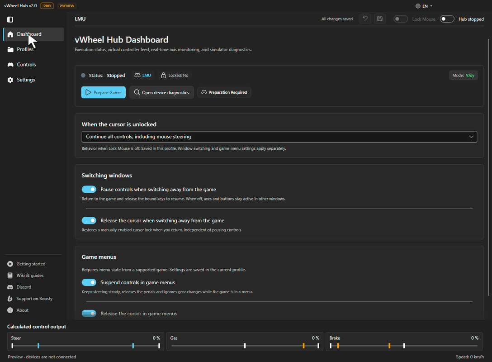

# 🏎️ VirtualWheel Hub

---

**vWheel Hub** is a desktop application for Windows and Linux (preview) designed for **Mouse Steering & Keyboard Control** in PC Sim Racing titles using **vJoy** on Windows and **uinput** on Linux.

It translates real-time mouse movement into ultra-smooth virtual wheel angles and maps keyboard keypresses to dynamic gas and brake axes with physical curve customization (attack, decay, gamma correction).

---

### 🖥️ Interface

---

### 🎮 Game Compatibility & Telemetry Support

> 💡 **Universal Compatibility:** Mouse steering and keyboard pedals work in racing games that accept a virtual controller, without needing telemetry.
>
> 🏎️ **Telemetry & Auto-Detection:** PRO telemetry features (ABS/TC Helpers, Speed-Sensitive Steering, Audio Slip Cues, In-Menu Control Suspension) and automatic game detection are supported for:
> * **Assetto Corsa** — Full Support (Telemetry & Auto-Detect)
> * **Assetto Corsa Competizione** — Full Support (Native Shared Memory Telemetry & Auto-Detect)
> * **Assetto Corsa EVO** — Full Support (Native Shared Memory Telemetry & Auto-Detect)
> * **Le Mans Ultimate** — Full Support (Shared Memory Plugin & Auto-Detect, supports 1000 Hz with DirectInput Fix)
> * **BeamNG.drive** — Full Support (Telemetry Mod & Auto-Detect)
> * **Automobilista 2** — Full Support (Telemetry & Auto-Detect)
> * **Forza Motorsport** — Experimental Telemetry Support (Data Out & Auto-Detect)
> * **WRC Generations** — UDP Telemetry & Auto-Detect
> * **iRacing** — Experimental Support (Auto-Detect Only)
> * **Dirt Rally 2.0** — Experimental Support (Auto-Detect Only)
> * **EA Sports WRC** — Experimental Support (Auto-Detect Only)
> * **Richard Burns Rally** — Experimental Support (Auto-Detect Only)
> * **Forza Horizon 4 / 5** — Auto-Detect Only
>
> *Once detected and plugin status is clear, you can customize sensitivity, curves, and keybindings to your exact liking.*

---

### 📌 Key Features

* **High-Precision Mouse Steering:** Converts raw mouse movement into virtual joystick output at up to **1000 Hz**, utilizing Windows high-resolution waitable timers and non-blocking accumulated Raw Input deltas.
* **Keyboard Steering Mode:** Full keyboard-only steering support with configurable ramp-up/ramp-down rates, instant full-lock snap, and a dedicated center-steering key.
* **Schema V2 dt-Based Pedal Physics:** Frame-rate and polling-rate independent gas and brake dynamics calculated via true delta-time physics, with seconds-based segment tuning and Turbo dual-key attack.
* **Smart In-Menu Controls & Cursor Locking:** In-menu control suspension, auto-unlocking cursor in menus, hold-to-unlock hotkey, and automatic game-exit cursor release.
* **Hierarchical Profile System:** Multi-tiered context profile inheritance (`Game` ➔ `Car Class` ➔ `Car Model`) with real-time undo/redo support (`Ctrl+Z` / `Ctrl+Y`).
* **Self-Learning Grip Engine (Pro):** Adaptive grip learning continuously learns dry and wet tire grip limits per vehicle.
* **Device Setup & Diagnostics:** Check your virtual wheel from Dashboard and follow the available setup steps. LMU also includes an input compatibility fix.

---

### 📊 Free (GitHub) vs Pro Feature Comparison

| Feature / Capability | Free (GitHub) | Pro Version (Boosty) |
| :--- | :---: | :---: |
| **Mouse Steering & Custom Curves (up to 1000 Hz)** | ✅ | ✅ |
| **Keyboard Steering Mode (Ramp-up/down, snap, center key)** | ✅ | ✅ |
| **Schema V2 dt-Based Gas & Brake Dynamics (Attack, Decay, Gamma, Turbo)** | ✅ | ✅ |
| **Universal Profile & Game / Class / Car Profiles** | ✅ | ✅ |
| **Real-Time Undo & Redo History** | ✅ | ✅ |
| **Custom Hotkeys, Dual Keybindings & Conflict Alerts** | ✅ | ✅ |
| **Profile Sharing (.vwh files & Share Codes)** | ✅ | ✅ |
| **vJoy Diagnostic & 1-Click Auto-Config** | ✅ | ✅ |
| **LMU Input Compatibility Fix (DirectInput Fallback @ 1000 Hz)** | ✅ | ✅ |
| **Game Process Auto-Detection** | ✅ (Process-based) | ✅ (Advanced + Plugins) |
| **Telemetry ABS Helper (Wheel Lockup Prevention & Rate Control)** | ❌ *(Unlock on Boosty)* | ✅ |
| **Smart Traction Control (TC Helper with Reactive Rates)** | ❌ *(Unlock on Boosty)* | ✅ |
| **Adaptive Grip Learning Cache & UI Tools** | ❌ *(Unlock on Boosty)* | ✅ |
| **Speed-Sensitive Steering (Dynamic Telemetry Scaling)** | ❌ *(Unlock on Boosty)* | ✅ |
| **Synthetic Trail Braking Engine** | ✅ | ✅ |
| **Slip Audio Feedback (Understeer / Oversteer Beeps)** | ❌ *(Unlock on Boosty)* | ✅ |
| **TC Audio Feedback (Wheelspin Beeps)** | ❌ *(Unlock on Boosty)* | ✅ |
| **In-Menu Control Suspension** | ❌ *(Unlock on Boosty)* | ✅ |
| **Auto-Unlock Mouse Cursor in Menu** | ❌ *(Unlock on Boosty)* | ✅ |
| **Automated Game Telemetry Plugin Installer** | ❌ *(Unlock on Boosty)* | ✅ |
| **Development Support & Priority Updates** | — | ❤️ Boosty Subscription |

---

### 🧩 Requirements

| Requirement | Details |
| :--- | :--- |
| **OS** | Windows 10/11 x64; Linux x64 builds are experimental |
| **Output** | Windows: [vJoy](https://github.com/jshafer817/vJoy/releases). Linux: uinput |
| **Runtime** | .NET is included in the downloads |
| **Privileges** | Standard user is enough to run the hub. Configuring vJoy requires a one-time Windows UAC confirmation |

---

### 🚀 Quick Start Guide

1. **Download and extract** the archive for your OS from [Releases](https://github.com/Barden-dev/VirtualWheel-Hub/releases).
2. **Launch the hub:** `vWheelHub.exe` on Windows, or `./vWheelHub` on Linux. Keep the `app` folder beside the launcher.
3. **Set up the virtual wheel:** on Windows, install [vJoy](https://github.com/jshafer817/vJoy/releases), then open device diagnostics on **Dashboard**.
4. **Configure your controls:** choose a profile, adjust steering and pedals, and assign your keys. Use Universal for games without a dedicated profile.
5. **Start the hub and assign controls in the game:** bind steering, throttle, brake and gears to the virtual device.

For Linux setup and game-specific instructions, see the [wiki](https://github.com/Barden-dev/VirtualWheel-Hub/wiki/Getting-Started).

---

### 🔗 Links & Community

* 🧡 **Boosty (Pro Build & Support):** [https://boosty.to/barden_dev](https://boosty.to/barden_dev)
* 💬 **Discord Community:** [https://discord.gg/YQn5eh2vfc](https://discord.gg/YQn5eh2vfc)
* 📖 **Wiki & Guides:** [https://github.com/Barden-dev/VirtualWheel-Hub/wiki](https://github.com/Barden-dev/VirtualWheel-Hub/wiki)

---

## 📜 License

Copyright (c) 2026 Barden-dev. All Rights Reserved. See [LICENSE](LICENSE) for details.
